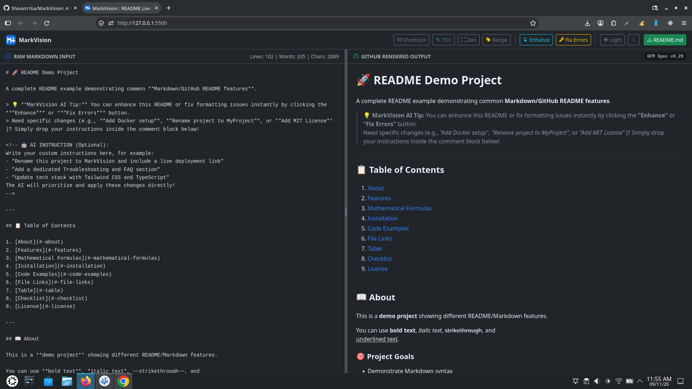
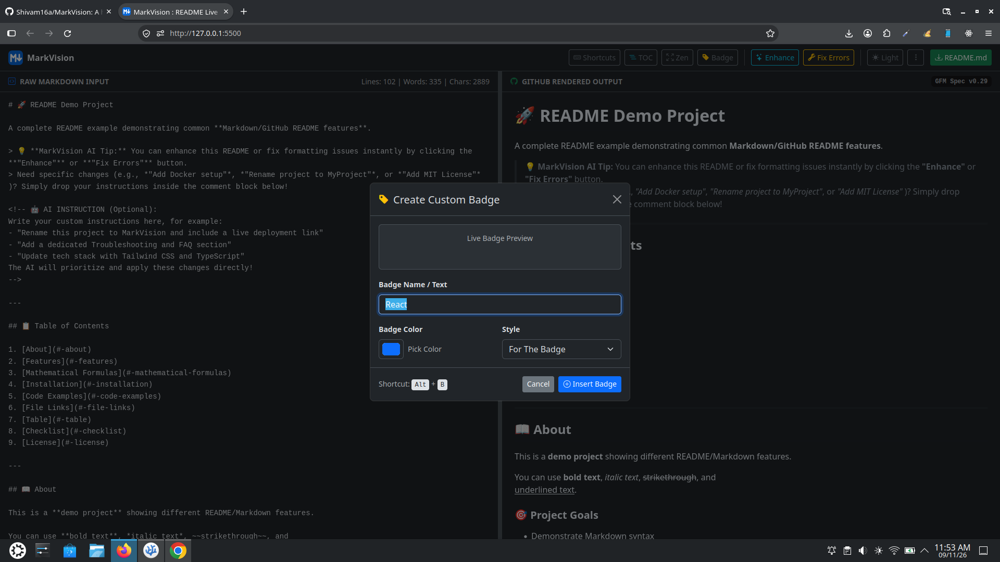
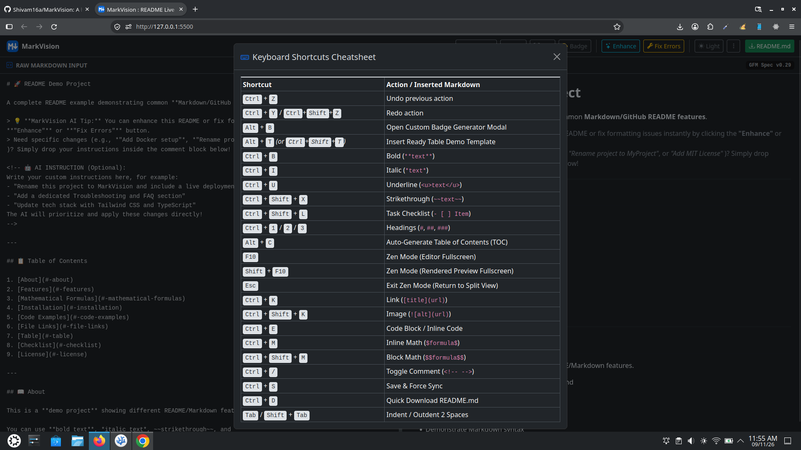

# MarkVision : GitHub README Live Previewer

A high-performance, responsive, browser-based GitHub Flavored Markdown (GFM) live editor and previewer built entirely with pure client-side JavaScript. MarkVision delivers an IDE-grade writing experience directly within modern web browsers without requiring backend infrastructure, cloud database dependencies, or build tools.

<p align="center">
  
</p>

---

## 📋 Table of Contents

- [Overview](#-overview)
- [Visual Walkthrough](#-visual-walkthrough)
- [Key Features](#-key-features)
- [How to Use MarkVision](#-how-to-use-markvision)
- [Architecture & Tech Stack](#-architecture--tech-stack)
- [Project Structure](#-project-structure)
- [Getting Started](#-getting-started)
- [Keyboard Shortcuts](#-keyboard-shortcuts)
- [Security Considerations](#-security-considerations)
- [Contributing](#-contributing)
- [License](#-license)

---

## 📖 Overview

Writing comprehensive GitHub `README.md` files often involves juggling syntax differences, verifying table layouts, formatting mathematical formulas, and embedding screenshots. MarkVision streamlines this workflow by offering a zero-setup, dual-pane workspace with synchronized scrolling, real-time LaTeX parsing, and intelligent asset handling.

Designed with a modular JavaScript architecture, MarkVision runs completely client-side, ensuring private, local editing with instant startup speeds.

---

## 🖼️ Visual Walkthrough

### 1. Dual-Pane Live Split View
The raw input editor and GitHub-rendered preview pane sync scrolling automatically, with line, word, and character metrics updating in real time.
<p align="center">
  
</p>

### 2. Custom Shields.io Badge Generator (`Alt + B`)
Create custom badges instantly with live preview, interactive color picker, and style toggles without writing raw markup manually.
<p align="center">
  
</p>

### 3. Integrated Keyboard Shortcuts Cheatsheet (`Ctrl + H`)
Built-in desktop shortcut guide for formatting, navigation, math injection, and Zen focus modes.
<p align="center">
  
</p>

---

## ✨ Key Features

### 1. Dual-Pane Synchronized Workspace
- Real-time Markdown parsing powered by **Marked.js**.
- Bidirectional percentage-based scroll synchronization between the raw editor and the rendered output pane.
- Draggable split-divider allowing customized pane width ratios on desktop displays.
- Responsive mobile layout with an Offcanvas tool drawer and dedicated tab switching between **Editor** and **Preview**.

### 2. Zero-Clutter Virtual Blob Image Engine
- Native drag-and-drop and clipboard paste (`Ctrl + V`) support for screenshots and local diagrams.
- Uses `URL.createObjectURL` in browser memory to eliminate massive Base64 strings from polluting the textarea editor.
- Automatic conversion of temporary blob links into standard `./assets/` relative file paths upon downloading `README.md`.

### 3. LaTeX Math & Syntax Highlighting
- Full block math (`$$...$$`) and inline math (`$...$`) rendering using **KaTeX**.
- Multi-language syntax highlighting through **Highlight.js** with GitHub light and dark color schemes.
- Automatic copy buttons attached to all rendered code blocks.

### 4. Custom Badge & TOC Generators
- **Custom Badge Modal (`Alt + B`)**: Real-time generation of custom Shields.io badges with label, color picker, and style toggles.
- **One-Click Table of Contents (`Alt + C`)**: Scans document headings, computes relative indentation levels, generates clean GitHub-compatible anchor slugs, and updates TOC blocks seamlessly.

### 5. IDE-Grade Editing & History Tracking
- Custom multi-step undo/redo stack (`Ctrl + Z` / `Ctrl + Y`) preserving cursor selection positions.
- Automatic quote and bracket pair matching (`()`, `[]`, `{}`, `""`, `''`, `` ` ``).
- Smart list continuation on Enter for bullet lists, numbered lists, and interactive GitHub checklists (`- [ ]`).
- Interactive preview checkboxes that allow ticking task items directly in the rendered view to update raw Markdown.

### 6. Distraction-Free Zen Mode
- **Zen Editor Mode (`F10`)**: Hides top navigations and preview panels for focused writing.
- **Zen Preview Mode (`Shift + F10`)**: Expands rendered Markdown to a full-width reading view.
- Quick exit back to split view via `Esc`.

---

## 🧭 How to Use MarkVision

### 1. Writing and Formatting
- Type or paste your Markdown in the **RAW MARKDOWN INPUT** pane on the left.
- Use familiar shortcuts like `Ctrl + B` for **bold**, `Ctrl + I` for *italics*, `Ctrl + U` for <u>underline</u>, and `Ctrl + Shift + X` for ~~strikethrough~~.
- Press `Alt + T` to insert a ready-to-use 3-column table template.

### 2. Attaching Images Without Clutter
- Copy any image to your clipboard and paste it (`Ctrl + V`) directly into the editor, or drag-and-drop an image file over the editor pane.
- MarkVision creates an in-memory virtual blob URL (``). The raw text stays short and lightweight while the preview renders the image immediately.

### 3. Adding Badges
- Click the **Badge** button on the navbar or press `Alt + B`.
- Enter your badge label (e.g., `Node.js`, `v2.0.0`), pick a color with the color picker, select a style (`for-the-badge`, `flat`, `flat-square`), and click **Insert Badge**.

### 4. Generating a Table of Contents
- Structure your document with headings (`#`, `##`, `###`).
- Click **TOC** on the navbar or press `Alt + C`.
- MarkVision scans your headings, calculates relative hierarchy levels, generates anchor links, and places a clean `Table of Contents` section right below your main title.

### 5. Entering Zen Focus Mode
- Press `F10` to hide all chrome, navbars, and preview panes for a distraction-free writing screen.
- Press `Shift + F10` to view the rendered preview in full screen.
- Press `Esc` anytime to return to the dual-pane split view.

### 6. Exporting Your README
- Click the green **README.md** button on the navbar (or on the mobile header), or press `Ctrl + D`.
- MarkVision automatically maps any temporary local blob image links to clean relative paths (`./assets/image-name.png`) and downloads the final `README.md` file to your computer.

---

## 🛠️ Architecture & Tech Stack

- **Markup & Styling**: HTML5, Bootstrap 5, Bootstrap Icons, GitHub Markdown CSS (`github-markdown-css`).
- **Core Markdown Parsing**: Marked.js (GFM compliant).
- **Sanitization & Security**: DOMPurify (configured with explicit URI regex rules for virtual blob handling).
- **Mathematics Engine**: KaTeX.
- **Syntax Highlighting**: Highlight.js.
- **State & Storage**: Pure Vanilla JavaScript (ES6+), Web Storage API (`localStorage`), Blob Memory API.

---

## 📂 Project Structure

```text
Readme_Previewer/
├── aifeatures.js         # Client-side AI interface and prompt handler
├── api/
│   └── gemini.js         # Serverless API endpoint handler (for proxying secure requests)
├── app.js                # Core editor logic, DOMPurify configuration, and scroll sync engine
├── badgegenerator.js     # Shields.io custom badge modal controller and shortcut handler
├── editorfeatures.js     # Drag-and-drop and clipboard Virtual Blob Image Engine
├── favicon.svg           # Application vector branding icon
├── images/
│   ├── custom_badge.png  # Screenshot: Custom Badge Generator modal
│   ├── home.png          # Screenshot: Split-screen main editor interface
│   └── shortcut.png      # Screenshot: Keyboard shortcuts cheatsheet modal
├── index.html            # Main markup, responsive offcanvas drawer, and modal dialogs
├── LICENSE               # Open-source MIT License terms
├── README.md             # Project documentation and user guide
├── style.css             # Custom workspace layouts, resizer styles, and Zen mode overrides
├── tocgenerator.js       # Relative hierarchy Table of Contents parsing engine
└── zenmode.js            # Fullscreen distraction-free layout state controller
```

---

## 🚀 Getting Started

Because MarkVision is built without build tools, node modules, or compile steps, running the application locally is straightforward.

### Prerequisites

A modern web browser supporting ES6 JavaScript (Google Chrome, Mozilla Firefox, Microsoft Edge, or Safari).

### Local Execution

1. Clone the repository:
   ```bash
   git clone https://github.com/Shivam16a/MarkVision.git
   cd MarkVision
   ```

2. Open `index.html` using a lightweight HTTP server to ensure local module loading and blob assets function as expected:
   - **Using Python 3:**
     ```bash
     python3 -m http.server 5500
     ```
   - **Using Node.js (`http-server`):**
     ```bash
     npx http-server -p 5500
     ```
   - **Using VS Code:** Install the **Live Server** extension and click **Go Live**.

3. Navigate to `http://localhost:5500` in your browser.

---

## ⌨️ Keyboard Shortcuts

| Shortcut | Description |
| :--- | :--- |
| <kbd>Ctrl</kbd> + <kbd>Z</kbd> | Undo previous change |
| <kbd>Ctrl</kbd> + <kbd>Y</kbd> / <kbd>Ctrl</kbd> + <kbd>Shift</kbd> + <kbd>Z</kbd> | Redo change |
| <kbd>Alt</kbd> + <kbd>B</kbd> | Open Custom Badge Generator Modal |
| <kbd>Alt</kbd> + <kbd>C</kbd> | Generate / Update Table of Contents |
| <kbd>Alt</kbd> + <kbd>T</kbd> | Insert standard table template |
| <kbd>F10</kbd> | Toggle Zen Mode (Editor Focus) |
| <kbd>Shift</kbd> + <kbd>F10</kbd> | Toggle Zen Mode (Preview Focus) |
| <kbd>Esc</kbd> | Exit Zen Mode back to standard split view |
| <kbd>Ctrl</kbd> + <kbd>B</kbd> | Wrap selection with **Bold** |
| <kbd>Ctrl</kbd> + <kbd>I</kbd> | Wrap selection with *Italic* |
| <kbd>Ctrl</kbd> + <kbd>U</kbd> | Wrap selection with <u>Underline</u> |
| <kbd>Ctrl</kbd> + <kbd>Shift</kbd> + <kbd>X</kbd> | Wrap selection with ~~Strikethrough~~ |
| <kbd>Ctrl</kbd> + <kbd>Shift</kbd> + <kbd>L</kbd> | Toggle task checklist line (`- [ ]`) |
| <kbd>Ctrl</kbd> + <kbd>1</kbd> / <kbd>2</kbd> / <kbd>3</kbd> | Apply Heading Level 1, 2, or 3 |
| <kbd>Ctrl</kbd> + <kbd>K</kbd> | Insert Hyperlink |
| <kbd>Ctrl</kbd> + <kbd>Shift</kbd> + <kbd>K</kbd> | Insert Image tag |
| <kbd>Ctrl</kbd> + <kbd>E</kbd> | Insert Code Block or Inline Code |
| <kbd>Ctrl</kbd> + <kbd>M</kbd> | Insert Inline Math (`$formula$`) |
| <kbd>Ctrl</kbd> + <kbd>Shift</kbd> + <kbd>M</kbd> | Insert Block Math (`$$formula$$`) |
| <kbd>Ctrl</kbd> + <kbd>/</kbd> | Toggle HTML comment block |
| <kbd>Ctrl</kbd> + <kbd>S</kbd> | Force Sync and persist to `localStorage` |
| <kbd>Ctrl</kbd> + <kbd>D</kbd> | Download `README.md` |
| <kbd>Tab</kbd> / <kbd>Shift</kbd> + <kbd>Tab</kbd> | Indent / Outdent 2 spaces |

---

## 🔒 Security Considerations

MarkVision parses raw HTML inputs alongside Markdown syntax. To protect against Cross-Site Scripting (XSS) vectors, all HTML generated by Marked.js passes through **DOMPurify** before injection into the preview DOM.

URI schemes are strictly enforced with custom validation regular expressions to allow legitimate secure resources (`https:`, `mailto:`, inline SVG structures, and memory-safe `blob:` identifiers) while dropping execution payloads.

---

## 🤝 Contributing

Contributions are welcome. If you would like to report an issue or propose an improvement:

1. Fork the repository.
2. Create your feature branch:
   ```bash
   git checkout -b feature/your-feature-name
   ```
3. Commit your changes:
   ```bash
   git commit -m "feat: add your feature description"
   ```
4. Push to the branch:
   ```bash
   git push origin feature/your-feature-name
   ```
5. Open a Pull Request on GitHub.

---

## 📄 License

This project is open-source software licensed under the [MIT License](LICENSE).